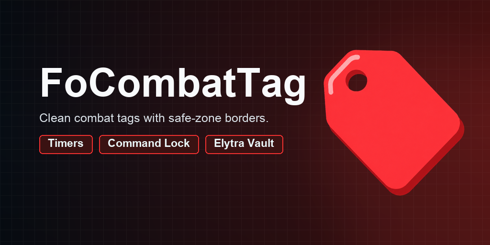
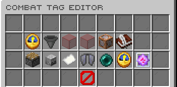
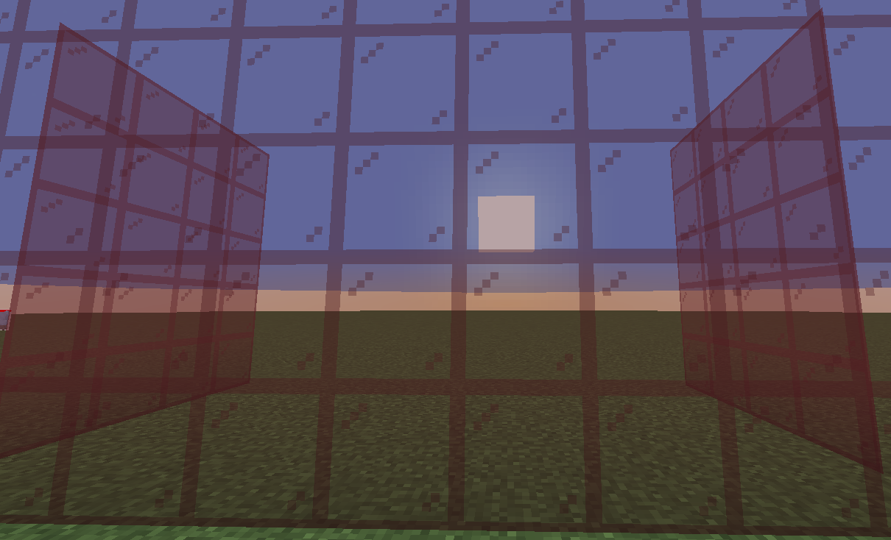

# FoCombatTag

[](https://modrinth.com/plugin/focombattag) [](https://modrinth.com/plugin/focombattag/versions) [](https://discord.gg/kEF77QCfu7)

Combat tagging with command restrictions, safe-zone protection, and integrations.

*Developed by Carrotio.*

## Features

- Tags players after configured combat actions and shows the remaining time.
- Blocks configured commands and applies combat-logout consequences.
- Protects WorldGuard no-PvP regions and supports optional team handling.
- Stores restricted elytras safely for later claiming.
- Provides a public API, Bukkit lifecycle events, and PlaceholderAPI status values.

## Download and dependencies

Download the latest compatible version from [Modrinth](https://modrinth.com/plugin/focombattag). Check the [versions page](https://modrinth.com/plugin/focombattag/versions) for supported Minecraft versions and server platforms.

- **Required:** None
- **Optional integrations:** `WorldGuard`, `FoTeams`, `Skript`, `PlaceholderAPI`

## Screenshots



*Configure combat-tag behavior.*



*Review WorldGuard border behavior.*

## Support

For help or issue reports, join the [Carrotio Discord server](https://discord.gg/kEF77QCfu7).

<details>
<summary><strong>Commands and permissions</strong></summary>

### Commands

- `/focombattagadmin [version|reload|editor|tag|untag|status]` — FoCombatTag admin command Aliases: `/combattagadmin`.
- `/elytravault` — Claim elytras stored while combat tagged

### Permissions

- `focombattag.admin` — Access to FoCombatTag admin tools Default: `op`.

</details>

<details>
<summary><strong>PlaceholderAPI</strong></summary>

Requires PlaceholderAPI.

- `%focombattag_tagged%` — Whether the player is combat tagged.
- `%focombattag_remaining%` — Remaining tag time with an `s` suffix.
- `%focombattag_remaining_raw%` — Remaining tag time in seconds.

</details>

<details>
<summary><strong>Configuration</strong></summary>

- `config.yml` — Main behavior and feature settings.
- `messages.yml` — Player-facing messages and interface text.
- `sounds.yml` — Configurable interaction sounds.

Main config areas: `combat`, `actionbar`, `combat-logout`, `native-dialogs`, `commands`, `worldguard`, `file-logging`.

</details>

<details>
<summary><strong>Developer API</strong></summary>

Compile against the matching jar (`provided` in Maven, `compileOnly` in Gradle); install it locally if needed. Declare `FoCombatTag` in your plugin metadata (`softdepend` for an optional integration).

```xml
<dependency>
  <groupId>me.foesio</groupId>
  <artifactId>FoCombatTag</artifactId>
  <version>2.3</version>
  <scope>provided</scope>
</dependency>
```

```java
import me.foesio.foCombatTag.api.FoCombatTagApi;
import me.foesio.foCombatTag.api.event.CombatLogoutPenaltyEvent;

FoCombatTagApi.get().ifPresent(api -> api.isTagged(player));

@EventHandler
public void onCombatLogoutPenaltyEvent(CombatLogoutPenaltyEvent event) {
    Bukkit.getLogger().info(event.getClass().getSimpleName());
}
```

**API methods** (overloads grouped):

- `FoCombatTagApi`: `get`, `isAvailable`, `install`, `uninstall`, `isTagged`, `getRemainingSeconds`, `tag`, `tagCombat`, `untag`, `getActiveTags`, `getTag`, `isNoPvpRegion`, `plugin`.

**Other API types:** `CombatTagCause`, `CombatTagDetails`, `CombatTagInfo`, `CombatTagRemoveReason`.

**Events:** `CombatLogoutPenaltyEvent`, `CombatTagAppliedEvent`, `CombatTagApplyEvent`, `CombatTagCommitEvent`, `CombatTagRemoveEvent`, `CombatTaggedCommandBlockEvent`, `ElytraVaultClaimEvent`, `ElytraVaultStoreEvent`.

[Browse API source](src/main/java/me/foesio/foCombatTag/api) for signatures and event details.

</details>
